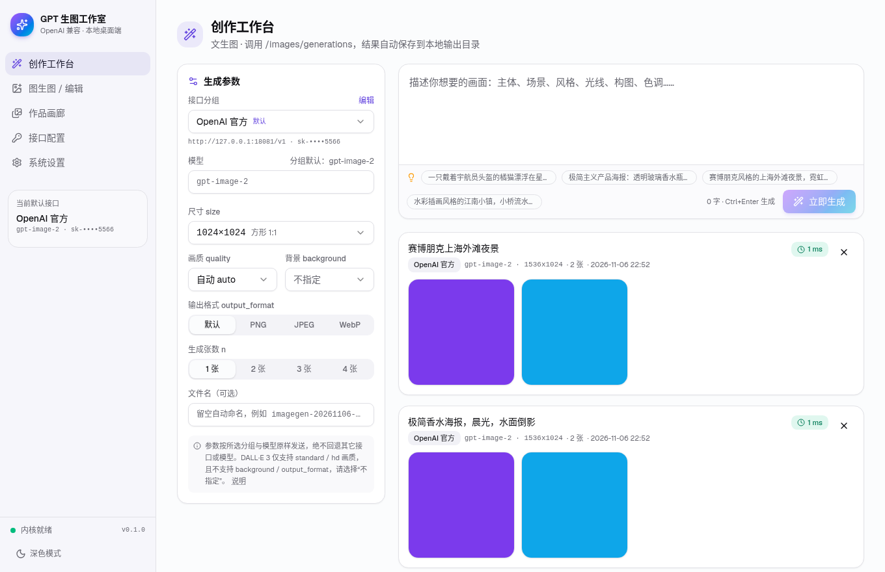
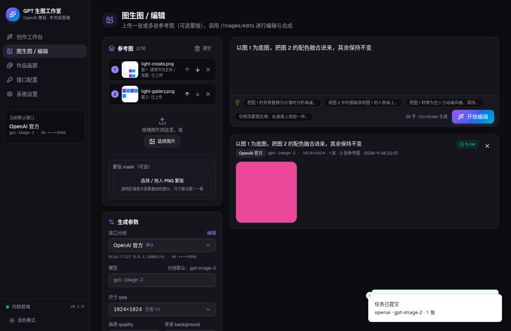
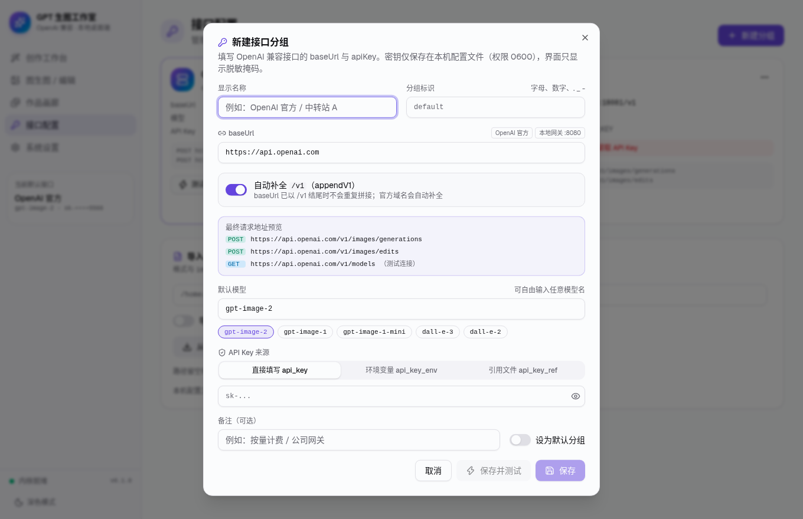
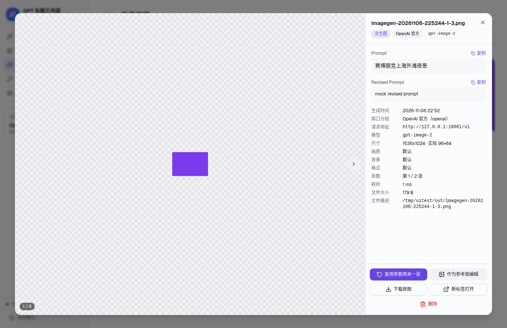
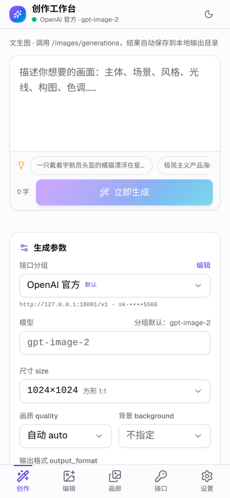
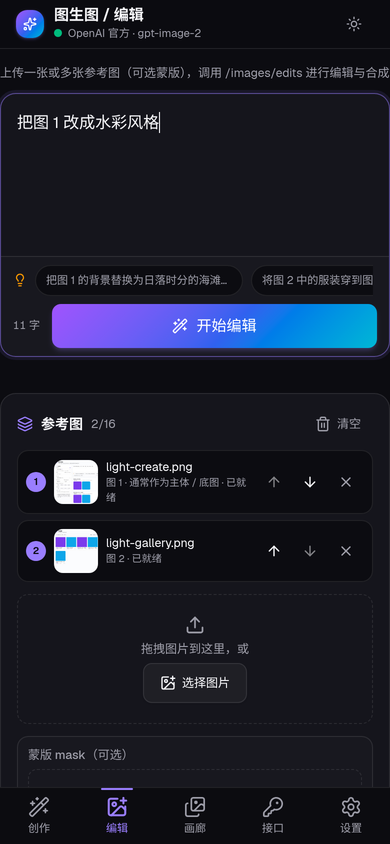
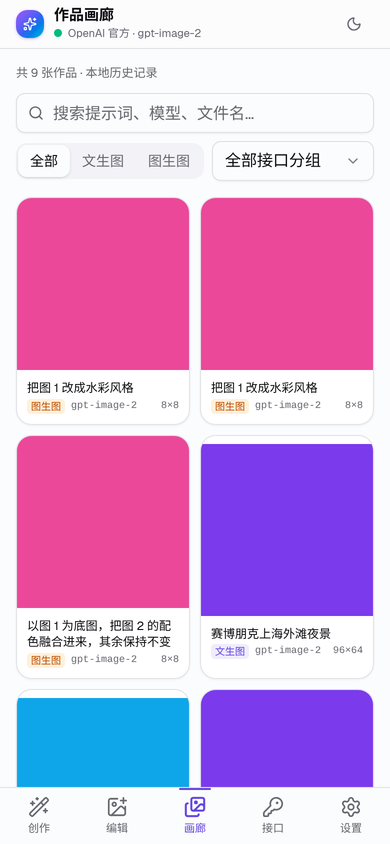
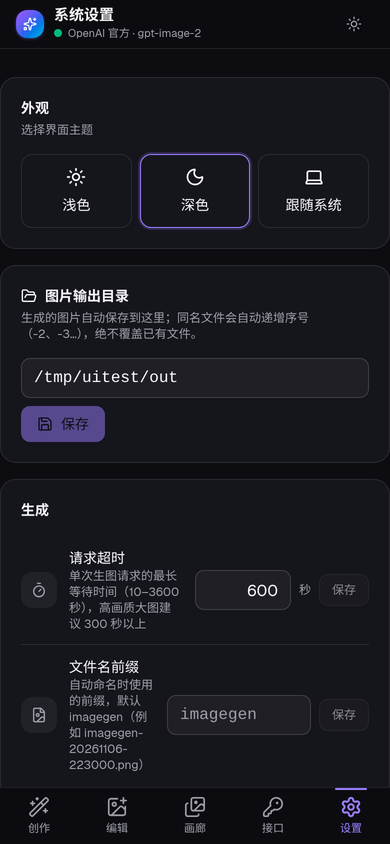

# GPT 生图工作室（GPTImageStudio）

一个专门调用 **OpenAI 兼容 GPT 生图接口** 的跨平台应用（**Windows / macOS / Android / iOS**）：用户自行配置 `baseUrl` 与 `apiKey`（支持多分组），即可文生图（`/images/generations`）、图生图 / 多图编辑（`/images/edits`），作品自动保存到本地并在画廊中统一管理。

- 桌面端做法与打包方式参考 [lan-sync](https://github.com/dimabehrs538-wq/lan-sync)：**Go 本地 sidecar 内核 + Tauri v2 + React 19 + Tailwind CSS v4 + shadcn/ui 风格组件**，GitHub Actions 自动打包 **Windows（NSIS 简体中文 / MSI）** 与 **macOS（Apple Silicon / Intel DMG）** 并联合发布、支持自动更新。
- **移动端（Android / iOS）**：同一套 Tauri v2 + React 界面，窄屏自动切换为顶部标题栏 + 底部五栏导航；内核换成 **App 进程内的 Rust 内核**（`app/src-tauri/mobile-core`），与 Go 内核的 `/api/*` REST + SSE 协议 **100% 一致**（`scripts/compare-cores.sh` 逐项比对）。CI 自动产出 **可直接安装的已签名 APK（v2/v3）+ AAB** 与 **未签名 IPA**（AltStore / Sideloadly 自签安装）。
- 接口调用规范对齐 `openai-image-api` 技能：分组配置、`append_v1` 规范化、`api_key` / `api_key_env` / `api_key_ref` 三种密钥方式、严格不回退、密钥绝不外泄、防覆盖落盘。

| 创作工作台 | 图生图（深色） |
| --- | --- |
|  |  |
| **接口分组配置** | **作品灯箱** |
|  |  |

| 移动端 · 创作 | 移动端 · 编辑（深色） | 移动端 · 画廊 | 移动端 · 设置（深色） |
| --- | --- | --- | --- |
|  |  |  |  |

---

## 功能一览

### 接口配置（baseUrl / apiKey，多分组）
- 「接口配置」页 + 全局快捷弹窗：填写 **显示名称、分组标识、`baseUrl`、`apiKey`、默认模型、`appendV1`**、备注；模型预设 `gpt-image-2`、`gpt-image-1`、`gpt-image-1-mini`、`dall-e-3`、`dall-e-2`，也可自由输入任意模型名。
- 多分组：新建 / 编辑（可重命名）/ 删除 / 一键设为默认；生图时可随时切换分组与模型。
- **URL 智能规范化与实时预览**：去掉末尾 `/`；开启 `appendV1` 或填写 `https://api.openai.com` 时自动补 `/v1`；已以 `/v1` 结尾则不重复拼接。弹窗中实时显示最终的 `POST …/images/generations`、`POST …/images/edits` 与 `GET …/models`。
- **密钥来源**三选一（与技能脚本解析优先级一致：`api_key_env` → `api_key` → `api_key_ref`）：
  - 直接填写 `api_key`（保存在 0600 配置文件中）；
  - 环境变量 `api_key_env`；
  - 引用文件 `api_key_ref`（`{ "path": "~/.secrets/x.json", "field": "a.b.key" }`）。
- **测试连接**：向 `{effectiveBaseUrl}/models` 发起鉴权探测，返回可用性、HTTP 状态、延迟，以及模型是否在列表中。
- **模型列表拉取与下拉选择**：用各分组自己的 baseUrl / appendV1 与密钥调用标准 `GET {effectiveBaseUrl}/models`，自动保存其中 **名称包含 `image`**（不区分大小写，去重排序）的模型 ID 到 数据目录下的 `models.json`（0600，不含任何密钥），重启后仍可用。
  - 这是 **名称匹配，不是能力检测**：不会用付费生图请求探测，也不会编造模型；名称不含 image 的兼容模型仍可直接手动输入。
  - 新建分组 / 没有缓存 / baseUrl 或密钥变化导致缓存失效时自动拉取一次（每个会话每个端点一次，失败不自动重试）；「创作」「编辑」参数面板的模型框、分组编辑弹窗和「接口管理」卡片都有手动刷新按钮，卡片显示「image 模型数 / 接口返回的不同模型数（重复 ID 去重后计数，不是原始条数）」。
  - 各分组列表相互隔离；端点或密钥变化后旧列表标记为失效、不再复用；刷新失败（超时 20 秒、401、404/405 不支持、非标准 JSON 等）保留旧列表并显示原因，此时可手动输入。
  - 模型框可选可输入：在某分组下选中的模型会记为该分组偏好（只存模型名），切换分组时恢复；留空 = 分组默认模型。拉取列表 **不会** 修改分组默认模型，也不会静默替换你已选的模型（不在列表中时只提示）。
- **导入 / 导出** `~/.codex/image-api-groups.json`（遵循 `CODEX_HOME`）：文件导入、粘贴 JSON 导入（合并或替换）、导出到文件（0600）、复制 JSON；导出默认 **不含** 明文 `api_key`，需手动勾选。

### 安全与“无回退”原则
- 配置文件、历史文件、`daemon.json` 均以 **0600** 权限原子写入。
- API 响应、日志、错误信息中 **绝不出现完整 apiKey**：界面只显示 `sk-••••abcd`；编辑分组时 apiKey 留空 = 保持原密钥；上游错误体中回显的密钥、`sk-…`、`Bearer …` 均被自动抹除。
- 严格使用用户选定的分组与模型：分组不存在、密钥解析失败、上游报错时直接返回清晰的 `HTTP 状态码 [错误码]：服务端信息`，**绝不静默切换到其它接口或模型**。
- 本地内核只监听 `127.0.0.1`，每次启动使用随机端口 + 随机 40 位 Bearer Token。

### 文生图 / 图生图
- 参数：Prompt、分组、模型、尺寸 `size`（`1024x1024` / `1536x1024` / `1024x1536` / `2048x1152` / `1792x1024` / `1024x1792` / `auto` / 自定义）、画质 `quality`（`auto` / `high` / `medium` / `low` / `hd` / `standard`）、背景 `background`（`auto` / `transparent` / `opaque`）、输出格式 `output_format`（`png` / `jpeg` / `webp`）、张数 `n`（1–4）、可选文件名。每个参数都可选“不指定”（请求中不发送该字段，兼容 DALL·E 3 等不支持某些字段的模型）。
- 图生图：拖拽或选择 **单张 / 多张参考图**（最多 16 张），可调整顺序（单张用 `image` 字段，多张按顺序用 `image[]` 字段上传），界面提示在 Prompt 中描述“图 1 / 图 2”各自的作用；可选 PNG 蒙版 `mask`。
- 响应兼容 `b64_json`（Base64 解码落盘）与 `url`（HTTP 下载落盘），记录 `revised_prompt`。
- 图片保存到输出目录（默认 `<用户目录>/GPTImageDesktop/output/imagegen`），按实际内容识别扩展名；**同名自动递增 `-2`、`-3`…（`O_EXCL` 创建），绝不覆盖已有文件**。
- 任务在内核中异步执行，通过 SSE 实时推送状态与耗时，可取消；完成后自动刷新画廊、弹出 Toast 与系统通知，托盘提示同步显示“GPT 生图 - 空闲 / 生成中…”。

### 作品画廊
- 网格缩略图（内核用标准库生成并缓存 JPEG 缩略图）、关键词搜索（Prompt / Revised Prompt / 模型 / 文件名）、按模式（文生图 / 图生图）与接口分组筛选、分页加载。
- 灯箱大图预览（← → 键切换）+ 完整元数据：分组、请求地址、模型、尺寸（含实际像素）、画质、背景、格式、耗时、文件大小、路径、Prompt / Revised Prompt、参考图与蒙版。
- 操作：复制提示词、打开所在目录、系统看图打开、**复用参数再来一张**、**作为参考图继续编辑**、删除记录（可选同时删除本地图片）。

### 桌面端体验（对标 lan-sync）
- 侧边栏 + 主工作区，全简体中文，浅色 / 深色 / 跟随系统。
- 系统托盘（打开主界面 / 退出、动态提示）；关闭窗口隐藏到托盘；单实例；开机自启（支持 `--minimized` 只驻留托盘）；系统通知；文件 / 文件夹选择对话框；在资源管理器 / Finder 中显示图片；软件自动更新（Windows + macOS）。
- **macOS 适配**：LaunchAgent 开机自启、菜单栏 **模板图标**（自动适配浅色 / 深色菜单栏）、关闭窗口后点击 **Dock 图标重新唤起主窗口**（`RunEvent::Reopen`）、标准 `.icns`（16–1024 全尺寸含 @2x）、ad-hoc 签名。
- 浏览器独立调试模式：`http://localhost:5173/?port=<端口>&token=<令牌>`。

### 移动端体验（Android / iOS）
- **响应式布局**：≥ 768px（`md`）保持侧边栏布局；窄屏为紧凑顶部栏 + 底部固定五栏导航（创作 / 编辑 / 画廊 / 接口 / 设置），适配刘海屏与手势条（`viewport-fit=cover` + `env(safe-area-inset-*)`；Android 另由原生层按系统栏 / 刘海 / 软键盘让位）。
- **参考图**：`<input type="file" accept="image/*" multiple>` 调起系统相册 / 相机 / 文件，图片以文件流上传到内核（`POST /api/uploads`），失败时回退 Base64。
- **保存与分享**：灯箱内「保存到相册」「分享图片」——Android 通过原生桥写入 `Pictures/GPTImageStudio`（MediaStore，免存储权限）并调起系统分享；iOS 通过系统分享面板（可「存储图像」到相册）。
- 移动端自动隐藏不适用的桌面功能：开机自启、桌面自动更新、打开资源管理器 / Finder 目录、选择输出目录。
- **进程内 Rust 内核**：监听 `127.0.0.1:0`（随机端口）+ 随机令牌，`core_info` 命令返回 `{port, token}`；数据存于 App 沙盒（`app_data_dir`）。支持分组、文生图、多图编辑（路径 / 上传文件流 / Base64）、`b64_json` 与 `url` 结果、防覆盖落盘、画廊、缩略图、SSE。
- 网络权限：Android `INTERNET` + `network_security_config` 仅对 `127.0.0.1` / `localhost` 放行明文；iOS `NSAppTransportSecurity → NSAllowsLocalNetworking = true`。

---

## 目录结构

```
gpt-image-desktop/
├── core/                         # Go 本地内核（零第三方依赖，CGO_ENABLED=0 静态编译）
│   ├── cmd/imagegend/main.go     # serve + CLI 子命令（status/groups/generate/edit/history/settings）
│   └── internal/
│       ├── config/               # 接口分组：codex 兼容格式、0600 落盘、URL 规范化、密钥解析与脱敏、导入导出
│       ├── imageapi/             # /images/generations、/images/edits、/models 客户端；错误解析脱敏；防覆盖保存
│       ├── engine/               # 一次完整生图流程：校验 → 调用 → 落盘 → 写历史
│       ├── store/                # 系统设置与作品历史（JSON 原子写入）
│       ├── server/               # 127.0.0.1 HTTP API + Bearer 鉴权 + SSE + 本地图片/缩略图读取 + 异步任务
│       ├── thumb/                # 标准库缩略图生成与缓存
│       └── rotlog/               # 按大小轮换的日志
├── app/                          # Tauri v2 + React 19 + TS + Vite + Tailwind v4 + shadcn/ui 风格组件
│   ├── src/
│   │   ├── App.tsx               # 侧边栏 + 主工作区
│   │   ├── pages/                # Create 创作工作台 / Edit 图生图 / Gallery 画廊 / Groups 接口配置 / Settings 设置
│   │   ├── components/           # ParamsPanel、RefImages、JobFeed、Lightbox、GroupDialog、ui/*
│   │   └── lib/                  # api.ts（内核通信）、store.tsx（SSE 数据中心）、updater.tsx（Win+Mac 更新）
│   ├── icon-src/make_icons.py    # Pillow 生成图标源文件 + 托盘图标
│   └── src-tauri/                # Rust 壳：桌面端（cfg(desktop)）sidecar、托盘、单实例、自启、updater；移动端（cfg(mobile)）进程内内核
│       ├── src/lib.rs · desktop.rs  # 公共命令 core_info 等 / 桌面专属逻辑
│       ├── mobile-core/          # Rust 移动内核 imagegen-mobile-core（axum + reqwest，协议与 Go 内核一致，可在桌面单测 / e2e）
│       ├── gen/android/          # Android 工程（原生桥 ImageBridge、窗口让位、network_security_config、发布签名配置）
│       ├── Info.ios.plist        # iOS 专用 Info.plist 片段（ATS 本地网络、相册权限说明），构建时自动合并
│       ├── tauri.{windows,macos,linux}.conf.json  # 仅桌面：externalBin sidecar + 更新产物
│       ├── tauri.{android,ios}.conf.json          # 仅移动端：Bundle ID com.gptimagestudio.mobile
│       ├── capabilities/         # default.json（全平台）/ desktop.json（托盘、自启、更新，仅桌面）
│       ├── icons/                # 桌面图标 + ios/ AppIcon 全套（Android mipmap 位于 gen/android）
│       ├── binaries/             # imagegend-<target-triple>[.exe]（由 build-core 生成，不入库）
│       ├── tauri.conf.json
│       └── tauri.nosign.conf.json  # 未配置签名私钥时关闭 updater 产物
├── scripts/
│   ├── build-core.sh             # Linux / macOS / Windows（amd64/arm64）交叉编译 sidecar，支持 macOS --universal
│   ├── build-core.ps1            # Windows PowerShell 编译（-H windowsgui 隐藏控制台）
│   ├── mock-openai.py            # 本地 Mock OpenAI 兼容接口（标准库）
│   ├── e2e.sh                    # 端到端联调脚本（CORE=go|rust）
│   └── compare-cores.sh          # Go / Rust 双内核协议一致性对比
└── .github/workflows/
    ├── build-windows.yml         # push main / 手动 / 被 release 调用：Windows NSIS + MSI
    ├── build-macos.yml           # push main / 手动 / 被 release 调用：macOS aarch64 + x64 DMG
    ├── build-android.yml         # push main / 手动 / 被 release 调用：已签名 APK（arm64/armv7/x86_64）+ AAB
    ├── build-ios.yml             # push main / 手动 / 被 release 调用：未签名 IPA（可选 Secrets 签名）
    └── release.yml               # 推送 v* 标签：并行构建四个平台 → 汇总 latest.json → 同一个 GitHub Release
```

数据目录（内核 `--home`，默认系统配置目录下的 `GPTImageDesktop`，可用 `IMAGEGEN_HOME` 覆盖）：

| 文件 | 说明 |
| --- | --- |
| `groups.json` | 接口分组（与 `image-api-groups.json` 同格式，0600） |
| `models.json` | 各分组拉取到的 image 模型列表缓存（0600，只含模型名、端点与指纹，不含密钥） |
| `settings.json` | 输出目录、请求超时、文件名前缀 |
| `history.json` | 作品历史 |
| `daemon.json` | 运行中内核的 `port` / `token` / `pid`（0600，退出时删除） |
| `inputs/` | 上传参考图的副本（用于“复用参数”） |
| `thumbs/` | 缩略图缓存 |
| `logs/imagegend.log` | 轮换日志（5 MB × 3） |

---

## 开发环境

| 工具 | 版本 |
| --- | --- |
| Go | ≥ 1.23 |
| Node.js | ≥ 20（推荐 22） |
| Rust | stable（Tauri v2） |
| 系统依赖 | Windows：WebView2 + VS C++ 生成工具；macOS：Xcode Command Line Tools；Linux：`libwebkit2gtk-4.1-dev` 等 |
| Android | JDK 17 + Android SDK（platform 36 / build-tools 35）+ NDK 27 |
| iOS | macOS + Xcode 15+ + XcodeGen（`brew install xcodegen`） |

```bash
# 1. 编译当前平台的 sidecar
./scripts/build-core.sh                # macOS 上自动识别 arm64 / amd64

# 2. 安装前端依赖并启动桌面端（开发模式）
cd app
npm install
npx tauri dev
```

### 浏览器调试模式（无需 Rust）

```bash
cd core && go run ./cmd/imagegend serve --api-port 18092 --token devtoken
cd app && npm run dev
# 浏览器打开 http://localhost:5173/?port=18092&token=devtoken
```

### 命令行调试

```bash
imagegend groups add --name openai --base-url https://api.openai.com --append-v1 --api-key sk-xxx --model gpt-image-2 --default
imagegend groups add --name relay  --base-url https://relay.example.com/v1 --api-key-env RELAY_KEY
imagegend groups test openai
imagegend groups import                          # 从 ~/.codex/image-api-groups.json 导入
imagegend groups export --path ~/.codex/image-api-groups.json   # 0600，默认不含明文密钥
imagegend generate --prompt "一只橘猫" --size 1536x1024 --quality high --n 2
imagegend edit --image a.png --image b.png --mask m.png --prompt "以图 1 为底图融合图 2 的配色"
imagegend history --q 橘猫 --mode generate --limit 10
imagegend settings --output-dir ~/Pictures/imagegen --timeout 900
imagegend status                                 # 查看运行中的内核
```

### 本地 HTTP API（Bearer Token 鉴权，仅 127.0.0.1）

| 方法 | 路径 | 说明 |
| --- | --- | --- |
| GET | `/api/status` | 内核状态 |
| GET | `/api/events?token=` | SSE：`job` / `history` / `groups` / `settings` |
| GET / POST | `/api/groups` | 分组列表（脱敏） / 新建 |
| PUT / DELETE | `/api/groups/{name}` | 更新（apiKey 留空保持原值，可 `newName` 重命名）/ 删除 |
| POST | `/api/groups/{name}/default` · `/test` | 设为默认 · 测试连接（`/models`） |
| POST | `/api/groups/preview` | baseUrl 规范化预览 |
| POST / GET | `/api/groups/import` · `/api/groups/export` | 导入（path / json，merge / replace）· 导出 |
| GET | `/api/models` | 各分组模型列表缓存 `{groups:{name:{models,total,fetchedAt,stale,error,…}}, filter:"image"}` |
| POST | `/api/groups/{name}/models` | 拉取并保存该分组的 image 模型列表，返回 `{ok, message, cache}`（失败时 `ok=false` 且保留旧列表；SSE 推送 `models` 事件） |
| GET / PUT | `/api/settings` | 系统设置 |
| POST | `/api/uploads?name=` | 上传参考图文件流（原始请求体，≤ 64 MB，仅图片），返回 `{name, path}` 供编辑引用 |
| POST | `/api/generate` · `/api/edit` | 提交异步任务（参考图支持 `path` 或 `dataUrl`） |
| GET | `/api/jobs` · `/api/jobs/{id}` · POST `/api/jobs/{id}/cancel` | 任务 |
| GET / DELETE | `/api/history` · `/api/history/{id}?deleteFile=1` | 画廊查询 / 删除 |
| GET | `/api/files?path=` · `/api/thumb?path=&w=` | 本地原图 / 缩略图（仅图片扩展名） |

---

## 测试

```bash
cd core && go test -v ./...      # 单元测试 + httptest 端到端
./scripts/e2e.sh                 # 真实启动 imagegend serve + Mock OpenAI 的完整闭环
CORE=rust ./scripts/e2e.sh       # 同一套闭环跑 Rust 移动内核
./scripts/compare-cores.sh       # Go / Rust 双内核逐项比对响应字段结构与状态码
cd app/src-tauri && cargo test -p imagegen-mobile-core   # Rust 移动内核单元测试
cd app && npm test               # 前端单测（vitest：更新检查、模型列表状态 / 偏好 / 自动拉取判定）
cd app && npm run build          # tsc 类型检查 + Vite 打包
```

Go 测试覆盖：URL 规范化、密钥脱敏与 Redact、`0600` 权限、三种密钥来源、导入导出、编辑时保留原密钥与重命名、文生图（b64 / url）、多图编辑 `image[]` 顺序与 `mask`、单图 `image` 字段、错误体解析与脱敏、`/models` 探测、模型列表拉取（名称过滤去重、多分组隔离、空列表 / 非标准响应 / 404 / 401 / 超时、端点变化失效、重启持久化、重命名迁移、不泄露密钥）、防覆盖落盘、历史筛选与删除、缩略图、日志轮换，以及经由本地 API 的“配置 → 测试 → 文生图 → 图生图 → 画廊 → 删除 → SSE”完整流程。

---

## 打包

### Windows

```powershell
./scripts/build-core.ps1
cd app; npm ci; npx tauri build --bundles nsis,msi
# 未配置更新签名私钥时：
npx tauri build --bundles nsis,msi --config src-tauri/tauri.nosign.conf.json
```

产物：`app/src-tauri/target/release/bundle/nsis/*-setup.exe`（简体中文安装界面）与 `bundle/msi/*.msi`。

### macOS（Apple Silicon / Intel）

```bash
xcode-select --install                       # 首次需要
rustup target add aarch64-apple-darwin x86_64-apple-darwin

# Apple Silicon
./scripts/build-core.sh macos arm64          # → binaries/imagegend-aarch64-apple-darwin
cd app && npm ci && npx tauri build --target aarch64-apple-darwin --bundles app,dmg

# Intel
./scripts/build-core.sh macos amd64          # → binaries/imagegend-x86_64-apple-darwin
npx tauri build --target x86_64-apple-darwin --bundles app,dmg

# 通用二进制（Universal）：在 macOS 上用 lipo 合成 sidecar
./scripts/build-core.sh macos --universal    # → binaries/imagegend-universal-apple-darwin
npx tauri build --target universal-apple-darwin --bundles app,dmg
```

未配置签名私钥时同样追加 `--config src-tauri/tauri.nosign.conf.json`。产物位于 `app/src-tauri/target/<target>/release/bundle/dmg/*.dmg`。

> **首次打开未公证的应用**：应用使用 ad-hoc 签名、未经 Apple 公证，首次打开可能提示“已损坏”或“无法验证开发者”。任选其一：
> - 打开 **系统设置 → 隐私与安全性**，在页面底部点击 **“仍要打开”**；或在 Finder 中右键应用 → 打开。
> - 终端执行：`xattr -cr /Applications/GPTImageStudio.app`
>
> 如需正式分发，可在 `tauri.conf.json` 的 `bundle.macOS.signingIdentity` 配置 Developer ID 证书，并在 CI 中配置 Apple 公证相关环境变量。

### Android（APK / AAB）

环境：JDK 17、Android SDK（platform 36、build-tools 35）、NDK 27（设置 `ANDROID_HOME` / `NDK_HOME`）、`rustup target add aarch64-linux-android armv7-linux-androideabi x86_64-linux-android`。

```bash
cd app && npm ci
# 发布签名（可选）：创建 src-tauri/gen/android/keystore.properties（已被 .gitignore 忽略）
#   storeFile=/绝对路径/release.jks
#   storePassword=…  keyAlias=…  keyPassword=…
npx tauri android build --apk --aab --target aarch64 armv7 x86_64
npx tauri android dev            # 连接手机 / 模拟器实时调试
```

产物：`src-tauri/gen/android/app/build/outputs/apk/universal/release/app-universal-release.apk` 与 `bundle/universalRelease/*.aab`。

**安装**：在 Actions 的 `GPTImageStudio-android` Artifact 或 Release 中下载 `GPTImageStudio_<版本>_android_universal.apk`，传到手机直接点击安装（首次需允许「安装未知来源应用」）。APK 使用 v2/v3 签名，支持 Android 7.0（API 24）及以上。

> 未在仓库 Secrets 中配置正式密钥库时，CI 会 **自动生成临时密钥库** 签名：可以直接安装，但每次构建的签名不同，**覆盖升级前需先卸载旧版**（数据会被清除）。想要稳定签名，请生成密钥库：
> `keytool -genkeypair -keystore release.jks -storetype PKCS12 -alias gptimagestudio -keyalg RSA -keysize 2048 -validity 10000`
> 然后在 **Settings → Secrets and variables → Actions** 新增：`ANDROID_KEYSTORE_BASE64`（`base64 -w0 release.jks` 的输出）、`ANDROID_KEYSTORE_PASSWORD`、`ANDROID_KEY_ALIAS`、`ANDROID_KEY_PASSWORD`（可选）。

### iOS（IPA）

**方式一：下载 CI 产出的未签名 IPA 自签安装（无需 Mac）**

1. 在 Actions 的 `GPTImageStudio-ios` Artifact 或 Release 中下载 `GPTImageStudio_<版本>_ios.ipa`（内含 `Payload/GPTImageStudio.app`，arm64，iOS 15+）。
2. 用 [AltStore](https://altstore.io/) / SideStore 或 [Sideloadly](https://sideloadly.io/) 以自己的 Apple ID 重签并安装：AltStore 在「My Apps」点 `+` 选择 IPA；Sideloadly 把 IPA 拖进窗口、填写 Apple ID 后点 Start。
3. 首次打开前：**设置 → 通用 → VPN 与设备管理** 信任你的开发者证书；iOS 16+ 还需打开 **设置 → 隐私与安全性 → 开发者模式**。免费 Apple ID 签名有效期 7 天，AltStore 可自动续签。

**方式二：本地 Xcode 构建**

```bash
xcode-select --install && brew install xcodegen      # 一次性
rustup target add aarch64-apple-ios aarch64-apple-ios-sim
cd app && npm ci
npx tauri ios init                                   # 生成 src-tauri/gen/apple（不入库）
cp src-tauri/icons/ios/*.png src-tauri/gen/apple/Assets.xcassets/AppIcon.appiconset/
npx tauri ios dev                                    # 模拟器 / 真机调试
npx tauri ios open                                   # 在 Xcode 中选择自己的 Team 后直接 Run 到手机
npx tauri ios build --target aarch64 --no-sign       # 仅打包未签名归档
```

**可选：CI 自动签名**——在 Secrets 中配置 `IOS_CERTIFICATE`（base64 的 .p12）、`IOS_CERTIFICATE_PASSWORD`、`IOS_MOBILE_PROVISION`（base64 的描述文件，Bundle ID `com.gptimagestudio.mobile`）、`APPLE_DEVELOPMENT_TEAM`，可选 `IOS_EXPORT_METHOD`（默认 `release-testing`），工作流会额外产出 `GPTImageStudio_<版本>_ios_signed.ipa`。

### 交叉编译 sidecar（任意平台验证）

```bash
./scripts/build-core.sh all     # linux/windows/macos × amd64/arm64
```

---

## GitHub Actions：自动打包与联合发布

| 工作流 | 触发 | 产物（Artifacts） |
| --- | --- | --- |
| `build-windows.yml` | push `main`、手动、被 release 调用 | `GPTImageStudio-windows-x64`（`.exe` + `.msi` [+ `.sig`]） |
| `build-macos.yml` | push `main`、手动、被 release 调用；矩阵 `aarch64-apple-darwin` / `x86_64-apple-darwin` | `GPTImageStudio-macos-aarch64`、`GPTImageStudio-macos-x64`（`.dmg` [+ `.app.tar.gz` + `.sig`]） |
| `build-android.yml` | push `main`、手动、被 release 调用（ubuntu-latest） | `GPTImageStudio-android`（已签名通用 `.apk` + `.aab`） |
| `build-ios.yml` | push `main`、手动、被 release 调用（macos-latest） | `GPTImageStudio-ios`（未签名 `.ipa` [+ 已签名 `_signed.ipa`]） |
| `release.yml` | 推送 `v*` 标签（或手动指定标签） | 并行调用上面四个工作流 → 汇总全部安装包（exe / msi / dmg / apk / aab / ipa）+ 桌面端多平台 `latest.json` → 发布到 **同一个 GitHub Release** |

桌面构建会先跑 `go test ./...`，再编译 sidecar → `npm ci` → `npx tauri build`；Android 构建会先跑 Rust 移动内核单测、Go / Rust 双内核协议一致性对比与 Rust 内核 e2e。

**下载安装包**：打开仓库 **Actions** → 选择最近一次「构建 macOS 安装包」/「构建 Windows 安装包」运行 → 页面底部 **Artifacts** 下载 `GPTImageStudio-macos-aarch64`（M 系列芯片）/ `GPTImageStudio-macos-x64`（Intel）/ `GPTImageStudio-windows-x64`，解压后即可得到 `.dmg` / `.exe` / `.msi`。打过 `v*` 标签后，也可直接在 **Releases** 页面下载。

### 自动更新

| 平台 | 方式 | 现状 |
| --- | --- | --- |
| Windows | Tauri updater 读取 Release 的 `latest.json` → 下载 NSIS 安装包 → minisign 签名校验 → 停止内核 → passive 安装后自动重启 | 本仓库已配置 `TAURI_SIGNING_PRIVATE_KEY`（与 `tauri.conf.json` 公钥 `AE09F86A862A1887` 配对），自 v0.1.1 起发布 `latest.json` + `.sig` |
| macOS | 同上，下载 `.app.tar.gz` 原地替换 `.app` 后重启 | 同上（Apple Silicon / Intel 各一个更新包） |
| Android | 查询 GitHub 最新正式版 → 展示更新说明 → 系统 DownloadManager 下载 APK → 校验包名 / 版本 / 签名证书 → 打开 **系统安装器由用户确认** | 自 v0.1.1 起使用项目固定签名；**不会静默安装**，首次需允许本应用「安装未知应用」 |
| iOS | 查询 GitHub 最新正式版 → 展示更新说明与下载页 | IPA 未签名，需用 AltStore / SideStore / Sideloadly 重新签名安装，**无法应用内更新** |

- 启动 15 秒后及每 4 小时自动检查（可在「系统设置 → 软件更新」关闭），也可手动检查；**检查失败时显示失败原因，不会误报“已是最新版本”**。
- 版本比较、GitHub Release 解析、资产挑选、平台判断、错误提示的单元测试：`cd app && npm test`。
- 校验更新签名：`python3 scripts/verify-updater-sig.py --latest-json latest.json --dir <下载目录>`（只用公钥，需 `cryptography`）。
- 未配置 `TAURI_SIGNING_PRIVATE_KEY` 时工作流自动改用 `tauri.nosign.conf.json`，照常产出安装包，只是不生成 `latest.json`（客户端收不到自动更新）。

> **v0.1.0 的升级限制**：
> - v0.1.0 桌面端已内置相同公钥与更新地址，v0.1.1 发布后可检测到更新。
> - v0.1.0 Android 版由 CI 临时密钥签名，该密钥构建后即销毁、**无法恢复**，因此从 v0.1.0 升级到 v0.1.1 **需要一次性卸载重装**（应用内数据会被清除，请先在画廊把作品「保存到相册」，并在「接口配置」导出分组）。v0.1.1 起使用固定签名，之后可覆盖升级。
> - v0.1.0 移动端没有内置检查更新功能，需要手动下载 v0.1.1。

签名密钥与口令只保存在维护者本机私有目录与仓库 Actions Secrets 中，绝不进入 git 或 Release（`release.yml` 发布前会拦截 `.key` / `.jks` / `.keystore` / `.p12` / `.properties` 等文件）。

配置自己的密钥（fork 时）：

1. 生成密钥对：`cd app && npx tauri signer generate -w ~/.tauri/gpt-image-studio-updater.key`，把 `.key.pub` 内容填入 `tauri.conf.json → plugins.updater.pubkey`（**更换公钥后，旧版本将无法验证新签名，只能手动升级一次**）。
2. `gh secret set TAURI_SIGNING_PRIVATE_KEY < ~/.tauri/gpt-image-studio-updater.key`（有口令时另设 `TAURI_SIGNING_PRIVATE_KEY_PASSWORD`）。
3. Android：`keytool -genkeypair -keystore release.jks -storetype PKCS12 -alias gptimagestudio -keyalg RSA -keysize 4096 -validity 36500`，然后 `base64 -w0 release.jks | gh secret set ANDROID_KEYSTORE_BASE64`，并设置 `ANDROID_KEYSTORE_PASSWORD` / `ANDROID_KEY_ALIAS` / `ANDROID_KEY_PASSWORD`。**请妥善备份密钥库，丢失后已安装用户将无法覆盖升级。**
4. 把 `plugins.updater.endpoints` 与 `app/src/lib/release.ts` 中的仓库地址改成你的仓库。

### 发布新版本

```bash
# 同步修改 app/src-tauri/tauri.conf.json、app/src-tauri/Cargo.toml、app/package.json 中的版本号
git commit -am "release: v0.1.1"
git tag -a v0.1.1 -m "更新说明……"   # 标签说明会写入 latest.json 的 notes
git push origin main --tags
```

`release.yml` 会校验标签版本与 `tauri.conf.json` 一致。客户端「系统设置 → 软件更新」可手动检查，默认每 4 小时自动检查：Windows 以 passive 模式运行安装程序后自动重启；macOS 原地替换 `.app` 后自动重启（更新前都会先优雅停止内核）。

---

## 常见问题

- **中转站不返回 `/models`？** 测试连接 / 模型列表拉取会如实显示失败信息，但不影响生图；在模型框直接输入模型名即可生成。
- **DALL·E 3 报参数错误？** DALL·E 3 只支持 `standard` / `hd` 画质，不支持 `background` / `output_format`，请把这些参数设为“不指定”。
- **生成很慢 / 超时？** 高画质大图可能需要数分钟，可在「系统设置 → 请求超时」调大（默认 600 秒）。
- **Mock 联调**：`python3 scripts/mock-openai.py --port 18080 --key sk-mock-123456789`，在应用中新建分组 `http://127.0.0.1:18080` + 该 key 即可完整体验。
